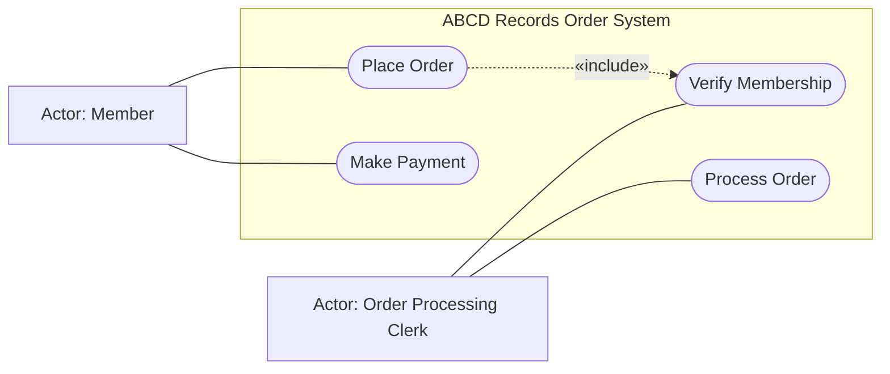
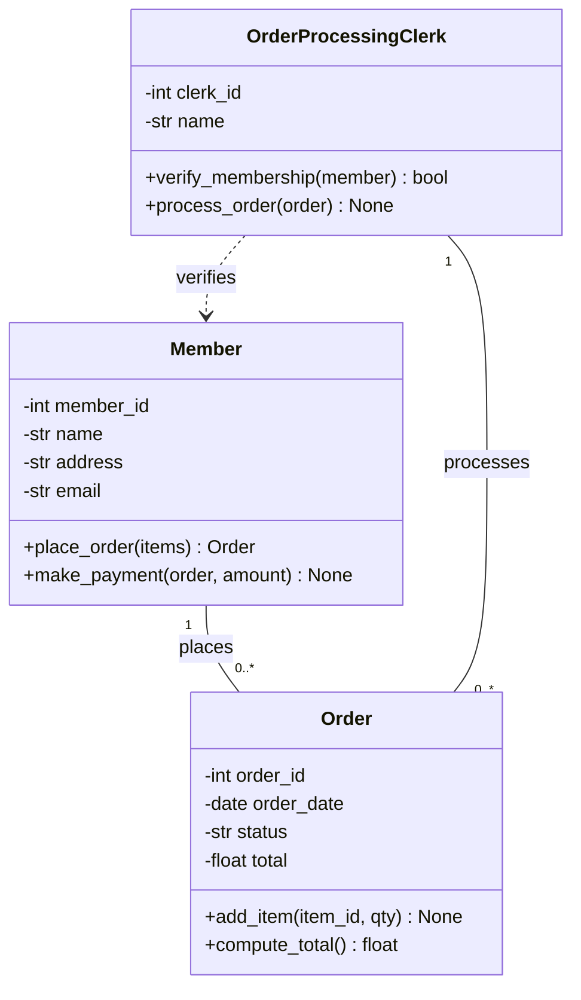
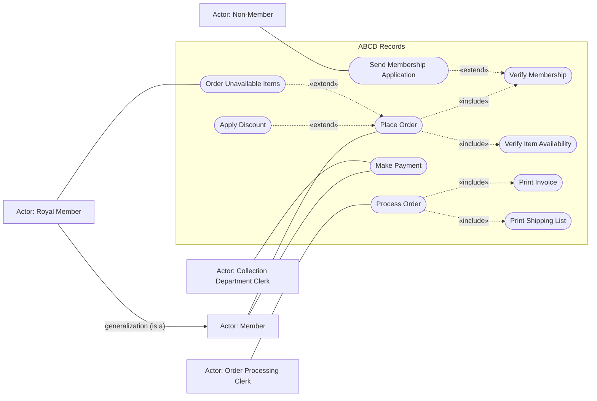
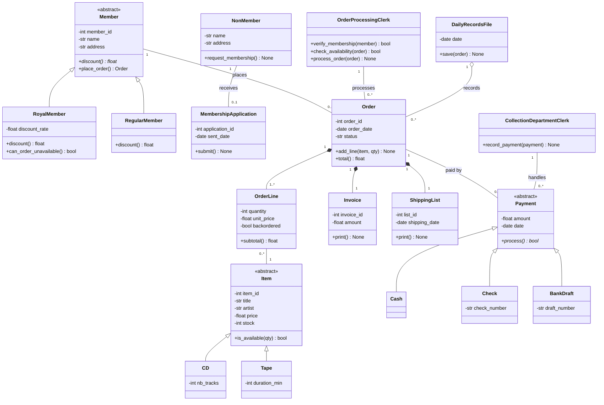
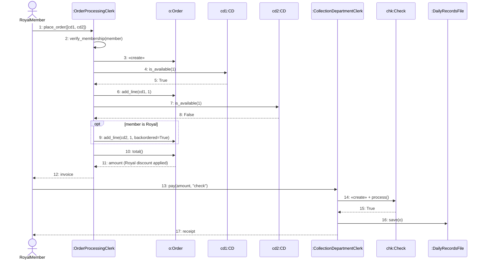
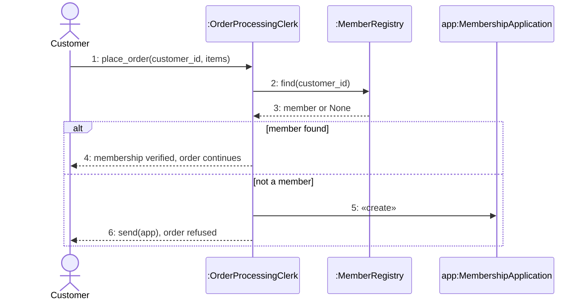
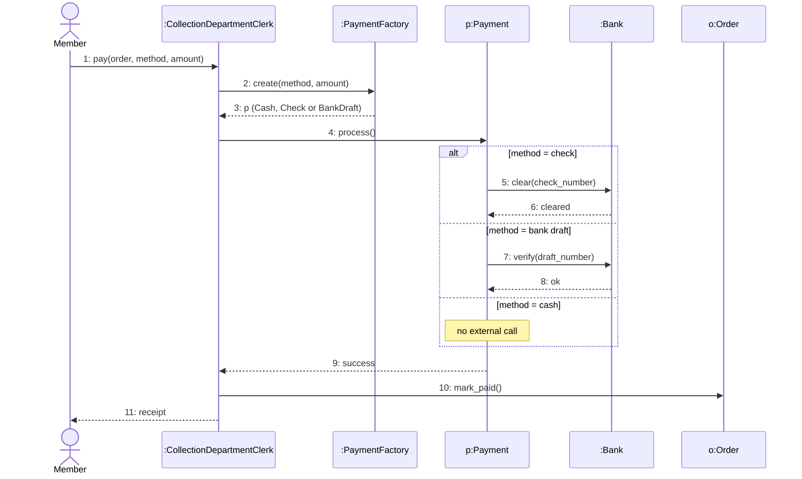
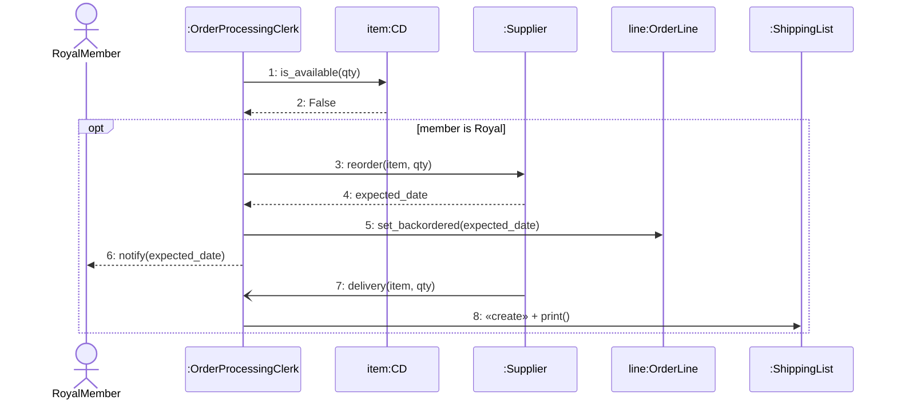
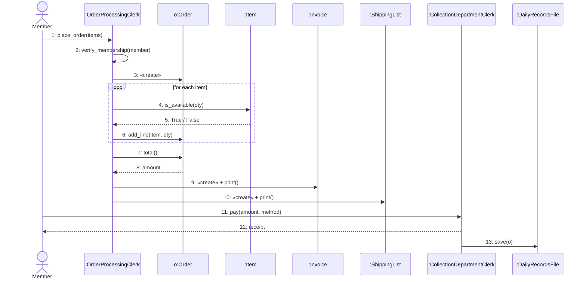

# UML practice · Exo 2 · ABCD Records

Business specification (from the course gist): ABCD Records is a mail-order company selling CDs and tapes at discount prices to record club members.

- Only members can place orders; non-members receive a membership application form.
- Two member classes: Royal (discounts + priority) and Regular.
- Royal members can order unavailable items.
- Payment methods: cash, check, bank draft.
- The Order Processing Clerk handles verification and processing.
- The Collection Department Clerk handles payments.
- All orders are saved to a daily records file.

> Use case diagrams are drawn with a Mermaid flowchart: the rectangle is the system boundary, rounded shapes are use cases, actors stay outside the boundary, dashed arrows are «include» / «extend».

---

## Level 1

### Task 1.1 · Simple use case diagram

### Task 1.2 · Basic class diagram

---

## Level 2

### Task 2.1 · Complete use case diagram

- «include» = mandatory: placing an order always verifies membership and availability; processing always prints the invoice and the shipping list.
- «extend» = optional: the discount and unavailable items only apply to Royal members; the application form is only sent when the membership check fails.

### Task 2.2 · Complete class diagram

### Sequence diagram · a Royal member orders 2 CDs (one unavailable) and pays by check

---

## Level 3 · Advanced sequences

### Membership verification (success and failure)

### Payment processing (all types)

### Item reordering for Royal members

### Complete order processing flow

