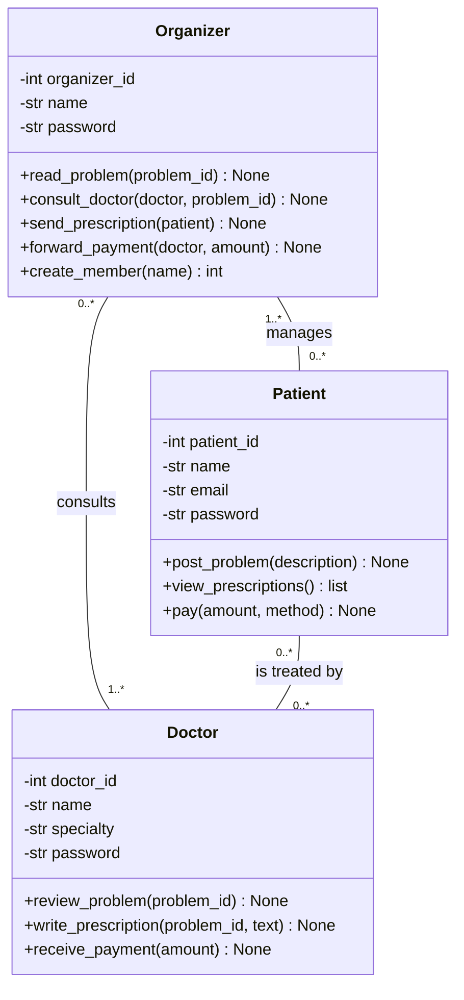
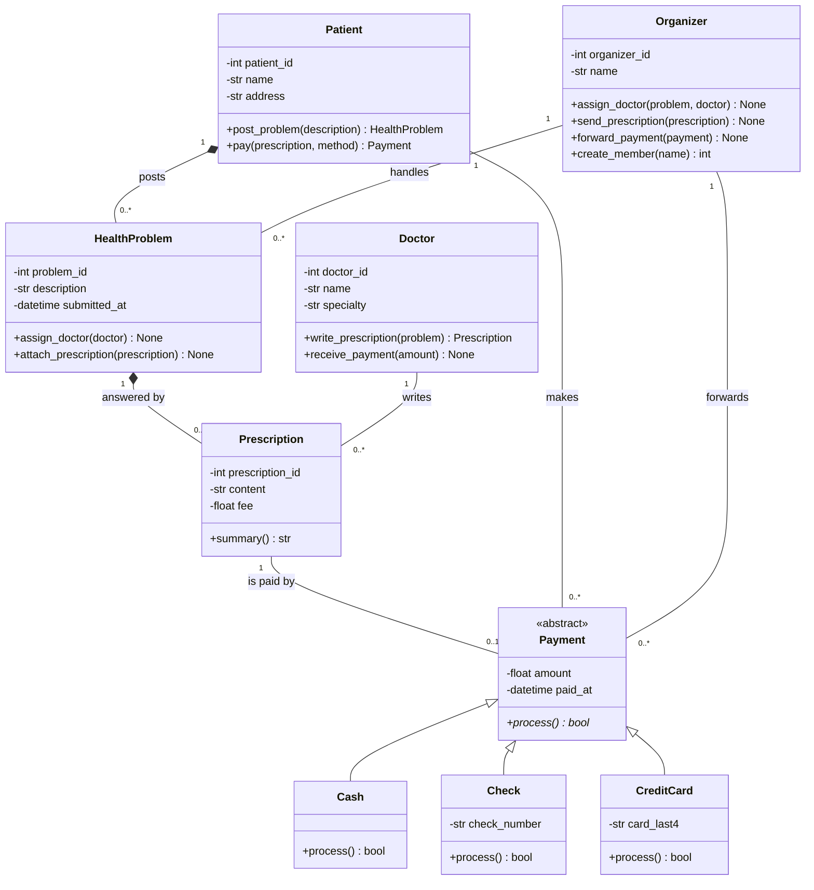
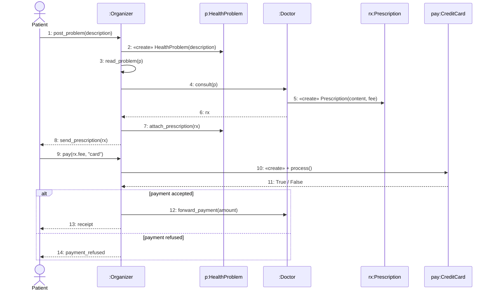
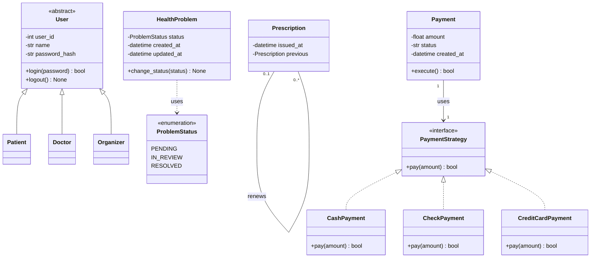
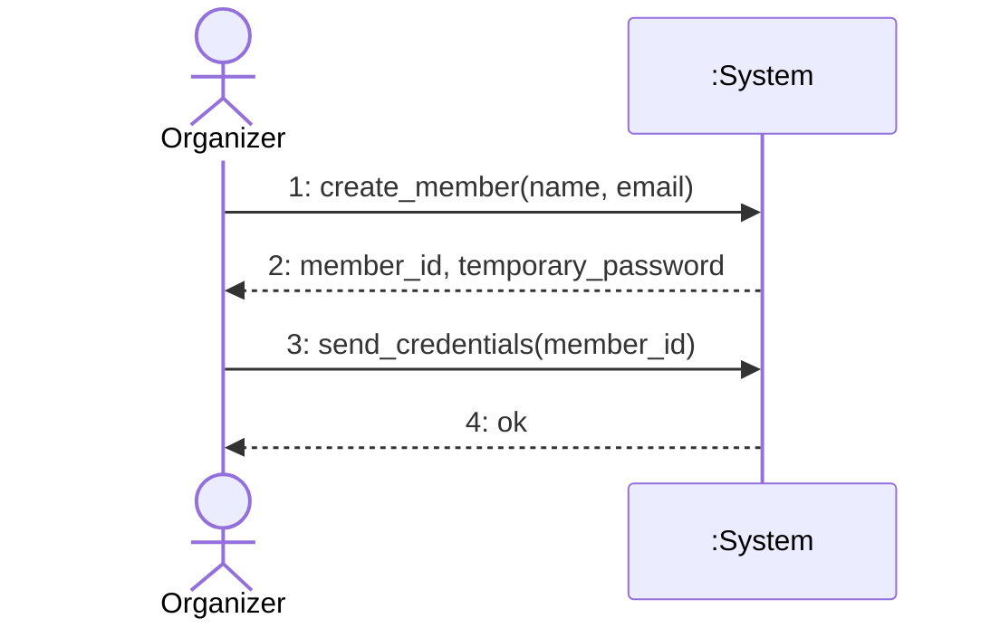
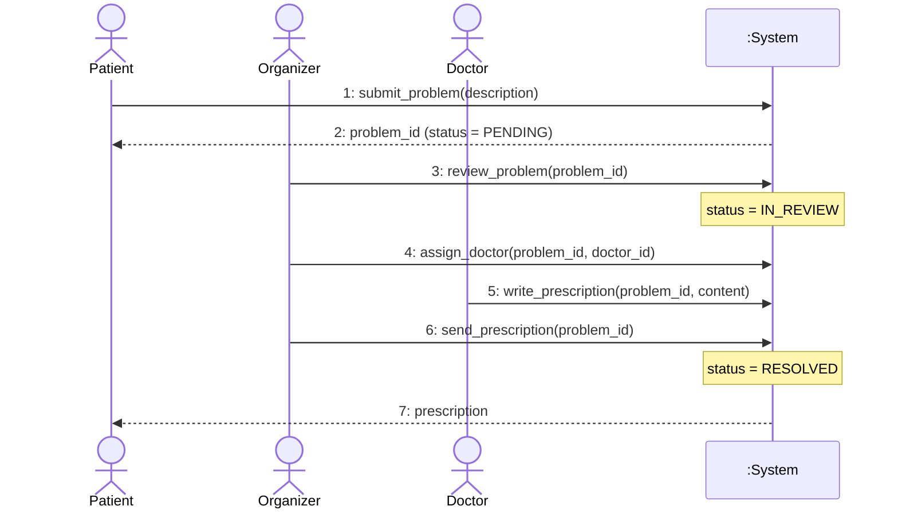
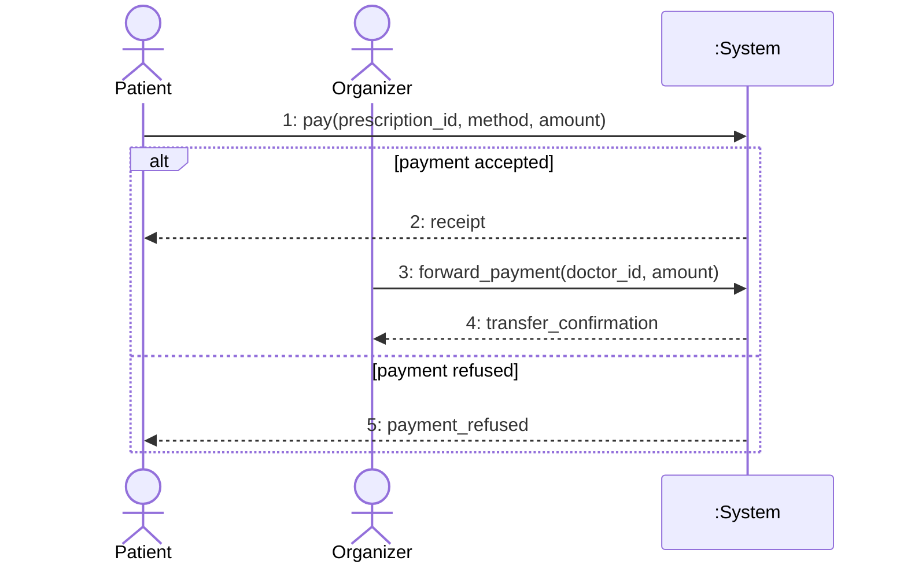

# UML practice · Exo 1 · Hospital Management System

Business specification (from the course gist):

- A patient posts a health problem online on the platform.
- The organizer reads the problem and consults a doctor.
- The doctor provides a prescription / solution.
- The organizer sends the prescription to the patient.
- The patient pays by check, cash or credit card.
- The organizer forwards the payment to the doctor.
- The organizer also acts as administrator: maintains the database, updates the system, issues member IDs and passwords.

---

## Task 1 · Basic class diagram (Patient, Doctor, Organizer)

At this stage the problem, the prescription and the payment are only parameters; task 2 turns them into classes.

---

## Task 2 · Complete class diagram (6 classes + payment types)

Design choices:

- **Composition** Patient → HealthProblem: a health problem does not exist without its patient.
- **Composition** HealthProblem → Prescription: a prescription answers one problem (0..1 until the doctor replies).
- **Inheritance** for the payment types: each one overrides `process()` (polymorphism).

### Sequence diagram · a patient submits a problem, receives a prescription and pays

---

## Task 3 · Advanced

### Class diagram additions

### System Sequence Diagram 1 · Patient registration

### System Sequence Diagram 2 · Consultation flow

### System Sequence Diagram 3 · Payment processing

### Questions to consider

- **A patient consulting multiple doctors**: make the HealthProblem–Doctor link `0..*` on the doctor side, or add a `Consultation` class (problem, doctor, date, opinion) to keep the history of each opinion.
- **Reusable prescriptions**: separate the reusable content (a `PrescriptionTemplate` / treatment) from the prescription issued to one patient on one date, or use the `previous` reference for renewals.
- **Design pattern for payment**: **Strategy** (one interchangeable strategy per payment method), often combined with a **Factory** that picks the strategy from "cash", "check" or "card".
- **Data integrity during payments**: atomic transaction (payment and forwarding succeed or fail together), a payment status (PENDING / PAID / FAILED), a unique payment id to avoid duplicates (idempotency), a timestamped log, and a check of the amount against the prescription fee.
